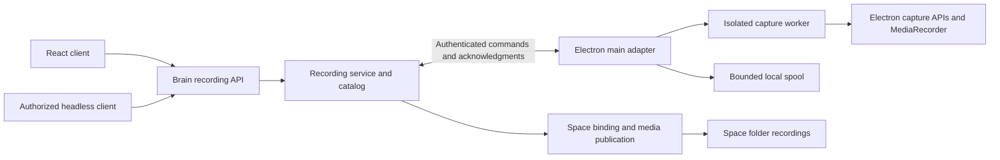

# Recording architecture and contracts

Status: Draft. Names and routes below are proposed, not existing APIs.

## Ownership



| Layer                   | Responsibility                                                                                    | Excluded responsibility                                                                       |
| ----------------------- | ------------------------------------------------------------------------------------------------- | --------------------------------------------------------------------------------------------- |
| Brain recording service | Authorization, scope, durable lifecycle, idempotency, clip catalog and publication                | Electron imports, media objects, React state and OS dialogs                                   |
| Electron main adapter   | Owned source resolution, permission status, worker lifecycle, chunk validation, spool and encoder | Product state in React, arbitrary client filesystem destinations and Run completion authority |
| Isolated capture worker | Stream, MediaRecorder, timestamps and bounded chunk delivery                                      | Filesystem access, credentials, workspace binding and policy                                  |
| React client            | Consent interaction, commands, backend state and playback                                         | Recording lifetime, timers, media writes and destination authority                            |

Use a feature-specific `RecordingProvider` port and registry. Tests inject a fake provider; deployments without Electron use an unavailable implementation. Do not add mandatory recording methods to every `IHands` or `IHardwareBridge` implementation.

## Adapter attachment and headless control

Electron main attaches to the managed Brain after backend readiness, using an authenticated loopback connection. Reuse the managed-backend port and local-control authentication pattern, with new recording-specific ownership checks. The renderer stream relay is a bounded-I/O reference, not an existing bidirectional recording transport.

Proposed transport: main registers its provider instance and authorized sources, then holds one authenticated SSE stream of leased commands from the Brain. It acknowledges commands and reports ordered progress and results through authenticated POSTs. SSE reuses the streaming pattern the Brain already serves for Runs and gives prompt disconnect detection; the Brain has no WebSocket endpoints, and adding one only for this adapter is not justified. Long polling is the fallback if a deployment cannot hold the stream. Either way, the service rejects stale generations, expired leases and wrong owners, and replay or reconnection cannot create duplicate streams. Provider reachability and actual frame progress are separate signals.

Use a provider-scoped credential bound to the desktop instance and backend generation. Keep it out of webviews and manifests. Do not accept arbitrary remote callback URLs. Local desktop/Brain pairing is the first-release scope; remote routing or media transfer is not implicit.

### Capture grant

A `CaptureGrant` is the Brain-held record that the user has approved capture of one owned source. Headless start depends on it, so its rules are explicit:

| Property   | Rule                                                                                                                                                                                                       |
| ---------- | ---------------------------------------------------------------------------------------------------------------------------------------------------------------------------------------------------------- |
| Issued by  | Electron main, after a desktop interaction in Eigent (the user chooses **Record** and confirms the consent dialog) and any OS permission the platform requires. The Brain records it when main reports it. |
| Scope      | Authenticated owner, provider instance and generation, and one owned source (the Eigent main window). Not scoped to a Space, Session or Run, so it can be reused for later Tasks in the same app session.  |
| Lifetime   | Ends on app quit, provider re-registration with a new generation, logout, explicit revoke in the UI, or loss of OS permission. No silent renewal across those events.                                      |
| Storage    | Opaque ID and scope in the Brain recording catalog. Never written to manifests, Space folders, webviews or logs.                                                                                           |
| Revocation | Stops any active recording using the grant with `grant_revoked`, preserving finalized clips. Later starts return `permission_required`.                                                                    |
| Not grants | OS Screen Recording permission alone, an agent prompt or tool call, and the generic Full access mode. None of these authorize capture.                                                                     |

Headless clients may start and stop a recording only while a live grant exists. First-use consent is always a desktop interaction. A Brain with no connected provider returns `provider_unavailable` while ordinary Task execution continues.

The grant outlives a single Task and any client holding local-control credentials can use it. A local process with those credentials could therefore start capture while Settings or other credential surfaces are on screen, with the app-wide indicator as the only safeguard. The phase-one security review decides whether that is acceptable or whether headless starts need an idle expiry (the grant lapses after a period without recording) or a desktop confirmation for each headless start.

### Concurrency

One provider has one owned source, so at most one recording is active per provider. A start while another recording is active returns `source_busy` with the active recording ID; it does not queue, switch the active Run or mix footage from two Runs. Concurrent Runs in other Sessions may be visible in the captured window; the recording stays associated with the Run that started it.

## Domain and proposed API

`RecordingScope` holds the existing `space_id`, `project_id`, `task_id` and `run_id`, plus the authenticated owner and provider identity. Validate identifiers against the authoritative Run. Never derive scope from a currently selected Space, caller-supplied email alone or an arbitrary root path.

`attempt_id` is not part of the immutable scope, because an explicit resume plans a new Attempt for the same Run. Each clip records the Attempt that was active when it started, validated against the Run at clip start. A clip never spans an Attempt boundary: resume starts a new clip. `attempt_id` may be `None` for a Run without a registered Attempt, and the catalog stores that as absent rather than inventing a value.

`Recording` holds an opaque ID, immutable scope, authorized source handle, grant, mode (`clip`, later `buffer`), state, requested/actual media profile, provider generation, timestamps and interruption reason.

`RecordingClip` holds an opaque clip ID, recording/scope association, `attempt_id`, relative path, MIME/container/codec, dimensions, cadence, duration, bytes, SHA-256 and capture timestamps. Optional bookmarks reference stable Run event IDs and offsets; they do not copy prompts/tool responses.

The provider port supports capabilities, source discovery, start, stop, reconciliation/status and later interval extraction. Its protocol is versioned plain data; Electron objects and media streams do not enter the Brain contract.

| Proposed endpoint                                        | Operation                                                                                    |
| -------------------------------------------------------- | -------------------------------------------------------------------------------------------- |
| `GET /recordings/capabilities`                           | Reachable providers, supported modes/formats, permission/source state and unavailable reason |
| `POST /recordings`                                       | Start with validated Run, source handle, grant and idempotency key; return durable ID/state  |
| `GET /recordings/{recording_id}`                         | Authoritative recording state and clips                                                      |
| `POST /recordings/{recording_id}/stop`                   | Idempotent stop, returning state without waiting for an entire encode                        |
| `GET /recordings?space_id=...&project_id=...&run_id=...` | Owner-filtered metadata listing; filters do not confer access                                |
| `POST /recordings/{recording_id}/clips`                  | Phase two: save a bounded interval, including last 30 seconds                                |

Registration, command polling and callbacks are internal adapter endpoints with separate authorization. Publish recording state through an authenticated versioned stream, with GET reconciliation after dropped connections. All clients consume the same service contract.

Typed reasons include `provider_unavailable`, `permission_required`, `permission_denied`, `grant_revoked`, `source_busy`, `source_ended`, `capture_stalled`, `workspace_rebound`, `disk_limit`, `encoder_unavailable` and `provider_disconnected`. Missing capability is a normal unavailable result; unauthorized commands are rejected. Never fall back from an unavailable owned window to capturing the whole screen.

## Lifecycle and recovery

```text
requested → awaiting_permission → starting → recording → stopping → finalizing → completed
                       ↘ denied       ↘ failed           ↘ interrupted / failed
```

`awaiting_permission` applies only to a start made from the desktop UI while the consent dialog or an OS permission prompt is open; only that desktop interaction moves it to `starting` or `denied`. A headless start never enters this state: without a live grant it is rejected synchronously with `permission_required` and creates no recording. A start under a live grant goes straight to `starting`. Persist compare-and-set transitions in a Brain-owned recording catalog. Stop/callback retries must not duplicate media or metadata. Preserve valid clips when recording ends unsuccessfully.

- Run completion, cancellation or failure requests stop; recording cannot reactivate a terminal Run.
- Run pause stops the current clip. Resume may create a new clip, tagged with the new Attempt, under the still-valid grant and with an explicit gap. React page navigation does not change capture ownership.
- Switching Space does not rebind a recording. Logout, unbind, owned-source closure or provider loss stops/interrupts capture.
- Backend restart reconciles immutable provider handles against the catalog. A renewable lease causes orphan workers to stop after bounded expiry.
- Lock/sleep/minimization/stalls produce truthful outcomes and interruption intervals. Do not claim missing time was filmed or change system lock settings automatically.

Finalization is independent of the agent. A slow encoder, denied permission or disk error cannot fail or indefinitely delay a successful Task. A bounded stop deadline releases resources and preserves recoverable segments.

## Electron media pipeline

Phase zero chooses between two capture routes. Both feed a MediaRecorder in a dedicated capture worker.

| Route                  | Mechanism                                                                                                                                                                                                                        | Trade-off                                                                                                                                                                                                                                                                                                                                                  |
| ---------------------- | -------------------------------------------------------------------------------------------------------------------------------------------------------------------------------------------------------------------------------- | ---------------------------------------------------------------------------------------------------------------------------------------------------------------------------------------------------------------------------------------------------------------------------------------------------------------------------------------------------------- |
| OS window capture      | `desktopCapturer.getSources` resolves the owned window's media-source ID. The worker opens it with `getDisplayMedia` through `session.setDisplayMediaRequestHandler`, or with `getUserMedia` and `chromeMediaSource: 'desktop'`. | Captures the composed window, including the embedded browser `WebContentsView`. Needs OS screen-recording permission on macOS. `getDisplayMedia` requires user activation; the `getUserMedia` path does not and is the headless-start fallback.                                                                                                            |
| Own frame subscription | `webContents.beginFrameSubscription` on the main window and each embedded `WebContentsView`, composited onto a canvas in the worker and captured with `canvas.captureStream`.                                                    | Needs no OS permission, because Eigent records only its own web contents. Frames arrive on paint rather than at a fixed rate, and the worker must reproduce view layout and bounds. Frames are delivered to main as bitmaps, so compositing in the worker copies each frame across processes: about 8 MB per 1080p RGBA frame, roughly 200 MB/s at 24 fps. |

For OS capture, match verified ownership and ID, never a title or the first source. Confine the request handler to the worker's dedicated session; do not globally broaden existing webview permissions. Never fall back to a screen source.

Phase zero also checks a variant of own-content capture: `setDisplayMediaRequestHandler` can answer with a `WebFrameMain` instead of a desktop source, which should need no OS permission. It captures only that frame's web contents, so embedded `WebContentsView` pages would be missing unless composited separately. Confirm this against the installed Electron 33 typings before relying on it.

The worker is an Electron-owned hidden BrowserWindow/recorder document separate from React, with context isolation, sandboxing and no Node integration. Set `backgroundThrottling: false` so the hidden window's timers, animation frames and MediaRecorder timeslices are not throttled; the canvas route depends on this. Main owns narrowly scoped chunk IPC and disposal. The installed Electron 33.4.11 types contain the relevant APIs, but source mapping, background behavior and codecs require the phase-zero spike.

Proposed default: silent video, target 24 fps and a maximum 1920×1080 envelope preserving source aspect ratio. Set `videoBitsPerSecond` explicitly rather than relying on the browser default; start at 2.5 Mbps, roughly 1.1 GB per hour, and tune from soak measurements. Roll to a new clip after 60 minutes. Stop with `disk_limit` when a per-Space recording budget (proposed 5 GB) or free-space floor is reached. Report actual media dimensions and cadence.

Select a MIME type and codec with `MediaRecorder.isTypeSupported`, trying `video/mp4;codecs=avc1` first. Electron 33 ships Chromium 130, and Chromium added MP4 output to MediaRecorder around version 126; whether it is available on every supported platform and build is a phase-zero question. Verify real bytes and playback; type support alone is not sufficient proof. Native `avc1` output still needs a recorded H.264 licensing decision before release, not only a separate encoder.

MediaRecorder WebM output has no duration and no seek index (Cues), so many players cannot seek it. A WebM original must have duration and Cues written at finalization before it is published as playable. Fragmented MP4 output needs the same playback and seeking check.

Main accepts timed chunks into a bounded spool with backpressure. Do not keep a long recording in one in-memory Blob. Stop tracks, release leases, close the worker and finalize the container on every stop/error path. A stalled writer is a recording error, not silent success.

Timeslice chunks are not assumed independently playable. Rolling-buffer extraction must preserve initialization data, keyframes and timestamps and produce a valid muxed clip. Arbitrarily concatenating recent chunks is not accepted. MP4 export needs a proved codec/muxer capability behind the adapter; do not assume an external `ffmpeg` installation or upgrade Electron without evidence.

## Storage, publication and artifacts

Resolve the trusted bound Space root, not an isolated agent worktree, transient `task_output_root` or renderer-provided absolute path. Final files live with the user's work:

```text
<Space root>/recordings/
  <YYYY-MM-DD_HHMMSS>_<short recording id>/
    clip_001.webm
    clip_001.mp4       # only after a successful optional export
    manifest.json
```

The folder name is the recording's local start time plus a short opaque suffix, so users can browse it without seeing backend terms. Backend identifiers, including `run_id` and each clip's `attempt_id`, live in `manifest.json` and the catalog, not in folder names.

Validate opaque identifiers and reserve non-overwriting destinations. An existing user `recordings/` directory does not automatically become managed storage; only catalog-reserved entries are owned. Spool data stays outside the source checkout in the owner's runtime area. The first release assumes the attached Electron and local Brain share the bound filesystem.

Revalidate owner, binding and root fingerprint at publication. Reject symlink escapes, rebinding and stale grants. Validate media, hash bytes, publish atomically and commit the catalog before advertising readiness. Write the sidecar manifest from the catalog atomically; recover crashes between rename and database commit without duplicate or false ready rows.

Captured pixels are local-only by default, including scratch Spaces. They must not inherit automatic agent-generated upload policy. Expose authorized metadata/local playback references without sharing the media automatically.

This is a real gap today, not a hypothetical one. In `backend/app/artifacts.py`, `_working_root_upload_policy` gives a Brain-owned scratch Space root the agent-generated upload policy, and `_artifact_upload_policy` opts out only `terminal_logs` and `todo.md`. A clip published under a scratch root during a Run's mutation window would be discovered and uploaded. Close it in two places:

- `_artifact_path_filter` excludes catalog-reserved recording paths from Run artifact discovery entirely, so they enter neither the upload lane nor the Run artifact manifest.
- `_artifact_upload_policy` returns metadata-only for any catalog-reserved recording path, as defence in depth.

Reserve the destination in the catalog when the recording starts, before any bytes are written, so discovery during the mutation window already sees it as managed. The classification uses catalog-reserved paths, not the folder name; do not add `recordings` to `_SPACE_INTERNAL_ARTIFACT_ROOTS`, because that would also exclude a user's own `recordings/` folder.

Clips therefore have exactly one association path, the recording catalog, whether they finalize during or after the Run. The current Run artifact manifest is immutable. Use an independently durable recording catalog associated with the Run, exposed through Space Files and a catalog-backed Session clip list. A clip finalized after `run.completed` does not rewrite historical Run artifacts or turn on new Run writes.

Coordinate publication with workspace mutation ownership. Current path policy treats ordinary videos as content and tracked content wins. Add only a narrowly catalog-authorized classification for untracked managed capture media/spool data so agent checkpoints and generic uploads do not accidentally collect it. Do not blanket-exclude videos or user `recordings/` folders, rewrite `.gitignore`, or remove tracked content. Existing tracked destinations must retain the tracked-content contract; test this policy change independently.

## Thin UI and product contract

Add a typed optional recording host slice for desktop source/consent interaction. Components use `useHost()` for that local capability and a frontend API service for domain operations; never direct `window.electronAPI` access or platform detection in feature components. React unmount does not dispose the recorder.

Reuse [Session header](../../src/components/Session/HeaderBox/index.tsx), [ContentHeader](../../src/components/Layout/ContentHeader.tsx), [Top bar](../../src/components/TopBar/index.tsx), existing Files/video preview, `Button`, `DsText`, `DsIcon`, tooltip and dialog primitives. Proposed control axes: header buttons `size="sm"`, `ghost`/`secondary`; icon recipe `main`; supported Ink/status roles, semantic spacing and shared focus treatment. No raw red, arbitrary geometry or decorative recording pulse.

The start control lives in the Session header. While any recording is active, an app-wide indicator in the top bar shows **Recording** with elapsed time and a **Stop recording** control on every page, including Settings and other Sessions. It appears for recordings started by headless clients too, because the user must always be able to see and stop capture of their window. The consent dialog states that everything shown in the Eigent window is captured, including other Sessions, Settings and embedded browser pages.

Visible copy: **Record**, **Stop recording**, **Recording**, **Recordings**, and later **Save last 30 seconds**. Do not use "Run" in visible copy; it is a backend term that is not part of the Space → Session → Task hierarchy. State includes text/elapsed time, not a color-only dot. All normal Web/headless behavior remains available without a recorder; playback continues to follow the existing file-access contract. No new design exception is assumed.

## Platform references

- [Electron desktopCapturer](https://www.electronjs.org/docs/latest/api/desktop-capturer): capture sources and platform consent.
- [Electron session](https://www.electronjs.org/docs/latest/api/session): display-media request handling.
- [Electron webContents](https://www.electronjs.org/docs/latest/api/web-contents): `beginFrameSubscription` for own-content capture.
- [Electron BrowserWindow](https://www.electronjs.org/docs/latest/api/browser-window): isolated worker configuration.
- [MediaRecorder](https://developer.mozilla.org/en-US/docs/Web/API/MediaRecorder): stream encoding, MIME discovery and chunk events.

References document APIs, not guarantees for this checkout. Lock/background behavior, encoding, recovery and the source-composition path remain unvalidated until the spike passes.
