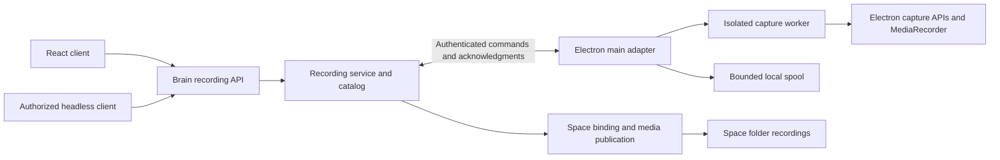

# Recording architecture and contracts

Status: Draft. Names and routes below are proposed, not existing APIs.

## Ownership



| Layer                   | Responsibility                                                                                    | Excluded responsibility                                                                       |
| ----------------------- | ------------------------------------------------------------------------------------------------- | --------------------------------------------------------------------------------------------- |
| Brain recording service | Authorization, scope, durable lifecycle, idempotency, clip catalog and publication                | Electron imports, media objects, React state and OS dialogs                                   |
| Electron main adapter   | Owned source resolution, permission status, worker lifecycle, chunk validation, spool and encoder | Product state in React, arbitrary client filesystem destinations and Run completion authority |
| Isolated capture worker | Stream, MediaRecorder, timestamps and bounded chunk delivery                                      | Filesystem access, credentials, workspace binding and policy                                  |
| React client            | Consent interaction, commands, backend state and playback                                         | Recording lifetime, timers, media writes and destination authority                            |

Use a feature-specific `RecordingProvider` port and registry. Tests inject a fake provider; deployments without Electron use an unavailable implementation. Do not add mandatory recording methods to every `IHands` or `IHardwareBridge` implementation.

## Adapter attachment and headless control

Electron main attaches to the managed Brain after backend readiness, using an authenticated loopback connection. Reuse the managed-backend port and local-control authentication pattern, with new recording-specific ownership checks. The renderer stream relay is a bounded-I/O reference, not an existing bidirectional recording transport.

Proposed transport: main registers its provider instance and authorized sources, then pulls leased commands through authenticated long polling. It acknowledges commands and reports ordered progress/results. The service rejects stale generations, expired leases and wrong owners; replay/reconnection cannot create duplicate streams. Provider reachability and actual frame progress are separate signals.

Use a provider-scoped credential bound to the desktop instance and backend generation. Keep it out of webviews and manifests. Do not accept arbitrary remote callback URLs. Local desktop/Brain pairing is the first-release scope; remote routing or media transfer is not implicit.

Headless clients may start/stop a recording once an explicit source/capture grant exists. First-use OS consent is a desktop interaction. An agent prompt or generic Full access mode does not grant desktop capture. A Brain with no connected provider returns `provider_unavailable` while ordinary Task execution continues.

## Domain and proposed API

`RecordingScope` holds the existing `space_id`, `project_id`, `task_id`, `run_id`, `attempt_id`, authenticated owner and provider identity. Validate identifiers against the authoritative Run. Never derive scope from a currently selected Space, caller-supplied email alone or an arbitrary root path.

`Recording` holds an opaque ID, immutable scope, authorized source handle, grant, mode (`clip`, later `buffer`), state, requested/actual media profile, provider generation, timestamps and interruption reason.

`RecordingClip` holds an opaque clip ID, recording/scope association, relative path, MIME/container/codec, dimensions, cadence, duration, bytes, SHA-256 and capture timestamps. Optional bookmarks reference stable Run event IDs and offsets; they do not copy prompts/tool responses.

The provider port supports capabilities, source discovery, start, stop, reconciliation/status and later interval extraction. Its protocol is versioned plain data; Electron objects and media streams do not enter the Brain contract.

| Proposed endpoint                                        | Operation                                                                                    |
| -------------------------------------------------------- | -------------------------------------------------------------------------------------------- |
| `GET /recordings/capabilities`                           | Reachable providers, supported modes/formats, permission/source state and unavailable reason |
| `POST /recordings`                                       | Start with validated Run, source handle, grant and idempotency key; return durable ID/state  |
| `GET /recordings/{recording_id}`                         | Authoritative recording state and clips                                                      |
| `POST /recordings/{recording_id}/stop`                   | Idempotent stop, returning state without waiting for an entire encode                        |
| `GET /recordings?space_id=...&project_id=...&run_id=...` | Owner-filtered metadata listing; filters do not confer access                                |
| `POST /recordings/{recording_id}/clips`                  | Phase two: save a bounded interval, including last 30 seconds                                |

Registration, command polling and callbacks are internal adapter endpoints with separate authorization. Publish recording state through an authenticated versioned stream, with GET reconciliation after dropped connections. All clients consume the same service contract.

Typed reasons include `provider_unavailable`, `permission_required`, `permission_denied`, `source_ended`, `capture_stalled`, `workspace_rebound`, `disk_limit`, `encoder_unavailable` and `provider_disconnected`. Missing capability is a normal unavailable result; unauthorized commands are rejected. Never fall back from an unavailable owned window to capturing the whole screen.

## Lifecycle and recovery

```text
requested → awaiting_permission → starting → recording → stopping → finalizing → completed
                       ↘ denied       ↘ failed           ↘ interrupted / failed
```

An authorized request can skip the permission state. Persist compare-and-set transitions in a Brain-owned recording catalog. Stop/callback retries must not duplicate media or metadata. Preserve valid clips when recording ends unsuccessfully.

- Run completion, cancellation or failure requests stop; recording cannot reactivate a terminal Run.
- Run pause stops the current clip. Resume may create a new clip under the still-valid grant, with an explicit gap. React page navigation does not change capture ownership.
- Switching Space does not rebind a recording. Logout, unbind, owned-source closure or provider loss stops/interrupts capture.
- Backend restart reconciles immutable provider handles against the catalog. A renewable lease causes orphan workers to stop after bounded expiry.
- Lock/sleep/minimization/stalls produce truthful outcomes and interruption intervals. Do not claim missing time was filmed or change system lock settings automatically.

Finalization is independent of the agent. A slow encoder, denied permission or disk error cannot fail or indefinitely delay a successful Task. A bounded stop deadline releases resources and preserves recoverable segments.

## Electron media pipeline

Use `desktopCapturer.getSources`, `session.setDisplayMediaRequestHandler`, owned window media-source identity and a dedicated capture worker's `getDisplayMedia` stream. Match verified ownership/ID, never a title or the first source. Confine the request handler to the worker's dedicated session; do not globally broaden existing webview permissions.

The worker is an Electron-owned hidden BrowserWindow/recorder document separate from React, with context isolation, sandboxing and no Node integration. Main owns narrowly scoped chunk IPC and disposal. The installed Electron 33.4.11 types contain the relevant APIs, but source mapping, background behavior and codecs require the phase-zero spike.

Proposed default: silent video, target 24 fps and a maximum 1920×1080 envelope preserving source aspect ratio. Report actual media dimensions/cadence. Select a supported MIME/codec with `MediaRecorder.isTypeSupported` and verify real bytes and playback; type support alone is not sufficient proof.

Main accepts timed chunks into a bounded spool with backpressure. Do not keep a long recording in one in-memory Blob. Stop tracks, release leases, close the worker and finalize the container on every stop/error path. A stalled writer is a recording error, not silent success.

Timeslice chunks are not assumed independently playable. Rolling-buffer extraction must preserve initialization data, keyframes and timestamps and produce a valid muxed clip. Arbitrarily concatenating recent chunks is not accepted. MP4 export needs a proved codec/muxer capability behind the adapter; do not assume an external `ffmpeg` installation or upgrade Electron without evidence.

## Storage, publication and artifacts

Resolve the trusted bound Space root, not an isolated agent worktree, transient `task_output_root` or renderer-provided absolute path. Final files live with the user's work:

```text
<Space root>/recordings/
  run_<run_id>/
    recording_<recording_id>/
      clip_001.webm
      clip_001.mp4       # only after a successful optional export
      manifest.json
```

Validate opaque identifiers and reserve non-overwriting destinations. An existing user `recordings/` directory does not automatically become managed storage; only catalog-reserved entries are owned. Spool data stays outside the source checkout in the owner's runtime area. The first release assumes the attached Electron and local Brain share the bound filesystem.

Revalidate owner, binding and root fingerprint at publication. Reject symlink escapes, rebinding and stale grants. Validate media, hash bytes, publish atomically and commit the catalog before advertising readiness. Write the sidecar manifest from the catalog atomically; recover crashes between rename and database commit without duplicate or false ready rows.

Captured pixels are local-only by default, including scratch Spaces. They must not inherit automatic agent-generated upload policy. Expose authorized metadata/local playback references without sharing the media automatically.

The current Run artifact manifest is immutable. Use an independently durable recording catalog associated with the Run, exposed through Space Files and a catalog-backed Session clip list. A clip finalized after `run.completed` does not rewrite historical Run artifacts or turn on new Run writes.

Coordinate publication with workspace mutation ownership. Current path policy treats ordinary videos as content and tracked content wins. Add only a narrowly catalog-authorized classification for untracked managed capture media/spool data so agent checkpoints and generic uploads do not accidentally collect it. Do not blanket-exclude videos or user `recordings/` folders, rewrite `.gitignore`, or remove tracked content. Existing tracked destinations must retain the tracked-content contract; test this policy change independently.

## Thin UI and product contract

Add a typed optional recording host slice for desktop source/consent interaction. Components use `useHost()` for that local capability and a frontend API service for domain operations; never direct `window.electronAPI` access or platform detection in feature components. React unmount does not dispose the recorder.

Reuse [Session header](../../src/components/Session/HeaderBox/index.tsx), [ContentHeader](../../src/components/Layout/ContentHeader.tsx), existing Files/video preview, `Button`, `DsText`, `DsIcon`, tooltip and dialog primitives. Proposed control axes: header buttons `size="sm"`, `ghost`/`secondary`; icon recipe `main`; supported Ink/status roles, semantic spacing and shared focus treatment. No raw red, arbitrary geometry or decorative recording pulse.

Visible copy: **Record run**, **Stop recording**, **Recording**, **Recordings**, and later **Save last 30 seconds**. State includes text/elapsed time, not a color-only dot. All normal Web/headless behavior remains available without a recorder; playback continues to follow the existing file-access contract. No new design exception is assumed.

## Platform references

- [Electron desktopCapturer](https://www.electronjs.org/docs/latest/api/desktop-capturer): capture sources and platform consent.
- [Electron session](https://www.electronjs.org/docs/latest/api/session): display-media request handling.
- [Electron BrowserWindow](https://www.electronjs.org/docs/latest/api/browser-window): isolated worker configuration.
- [MediaRecorder](https://developer.mozilla.org/en-US/docs/Web/API/MediaRecorder): stream encoding, MIME discovery and chunk events.

References document APIs, not guarantees for this checkout. Lock/background behavior, encoding, recovery and the source-composition path remain unvalidated until the spike passes.
